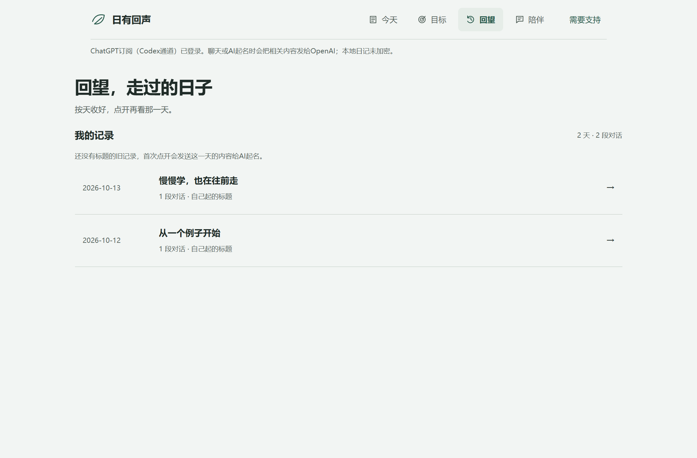

# 日有回声

[](COMMERCIAL.md)

一款中文Windows桌面成长陪伴体验版：把今天说清楚，继续聊下去，自主选择下一步。**源码公开协作，商业使用需另行授权。**采用[PolyForm Noncommercial 1.0.0](LICENSE)，属于源码公开许可，不是OSI定义的开源许可。作者：[zhouzi4449](https://github.com/zhouzi4449)。



[下载体验版与分享视频](https://github.com/zhouzi4449/day-companion/releases/tag/v0.8.0) · [商业授权咨询](https://github.com/zhouzi4449/day-companion/issues/new?template=commercial.yml) · [一起贡献](CONTRIBUTING.md)

## 0.8.0有哪些功能

- 打开后主动邀请聊今天；复盘后进入持续交流。回应按用户表达、自报状态和偏好动态生成，支持纠正误解、倾听或一起试办法。
- 温柔长者、知心姐姐、成年妹妹三种虚构成人风格；可设回复长度、坦诚程度和少追问。
- 自定目标、最小行动、行动时机，修改与当天完成/撤销；AI建议先确认才保存。
- 按天回望，列表收起正文，点开看具体对话；AI总结标题，也能手动编辑或重新起名。
- **52张原创资料卡，含28张方法卡**：学习、拖延、完美主义、沟通边界、担忧、现实联系和睡眠等，展示来源、依据类型、步骤、停止条件与核验日期。
- JSON备份导出与恢复：文件预览、取消、格式/体积校验，导入前留一份本机备份；恢复不调用AI、不改AI连接，历史授权重新关闭。
- 用户确认的事实记忆、聊天偏好与历史授权；生成失败保留草稿。

截图与视频均为示例数据。AI理解与建议可能出错；本产品提供一般成长支持，不提供诊断或保证效果。

## Windows用户怎么打开

在[Releases](https://github.com/zhouzi4449/day-companion/releases/tag/v0.8.0)下载Windows x64便携包，解压后双击 `DayCompanion/DayCompanion.exe`。必须保留整个目录。当前程序未签名，尚无安装器和自动更新；首次使用其他电脑、新账号和真实自选API仍需独立验证。

## 开发与验证

需要Node.js 22.12或更高版本。

```powershell
npm ci
npm test
npm start
npm run package:win
```

便携输出：`dist/releases/0.8.0/DayCompanion-win32-x64/`。可通过 `desktop/create-shortcut.ps1` 创建本机快捷方式。新功能沿用现有状态v1与旧知识卡ID，不迁移用户已有记录到服务器。

0.8.0在本机实际构建、运行：33项逻辑检查，7组恢复界面检查，并回归11组桌面、7组按天记录、6组交流模式；两轮真实订阅合成对话自审。CI检查源码逻辑，不冒充桌面、全部模型质量或长期效果验收。跨机器、专业审阅、长期用户内测、记录加密、签名与更新仍未完成，见[路线图](ROADMAP.md)。

## AI连接与数据

默认通过随包官方Codex CLI使用用户自己的ChatGPT订阅认证，消耗账户Codex额度；不把Plus视为API余额。也可使用兼容Chat Completions服务，自备模型与密钥，供应商费用另计。没有内置共享密钥、服务端、会员或广告。

日记、标题、事实记忆与导入前备份仍在本机**未加密**存储。API密钥独立用Windows DPAPI保护，不进入网页或备份。提交聊天会发送必要上下文，历史需授权；选中旧日生成标题会发送该日有限文字。导入备份不发送内容，下一次提交才使用相应对话上下文。官方临时会话不代表供应商零保留。

## 一起升级项目

欢迎报告问题、核对资料、补充原创知识卡、改进交互与可访问性。不会写代码也能通过[资料与体验建议表](https://github.com/zhouzi4449/day-companion/issues/new?template=knowledge.yml)参与。先看[贡献指南](CONTRIBUTING.md)、[知识库规范](docs/KNOWLEDGE.md)和[安全报告](SECURITY.md)。不要提交真实日记、访问令牌、私密聊天或整本教材。

## 分享视频与旁白

约95秒1080p社区分享片，中文合成旁白、20段同步字幕、原创轻音乐，结尾邀请大家一起报告问题、补资料、提交改进。文稿在 `promo/deliverables/日有回声-分享旁白.txt`，字幕在同目录 `日有回声-社区分享.srt`；成片在[Releases](https://github.com/zhouzi4449/day-companion/releases/tag/v0.8.0)。

```powershell
cd promo/studio
npm ci
npm run studio
npm run render:share
```

工程包含旁白分句音频。Windows装有简体中文SAPI语音时，可在根目录运行 `powershell -File promo/make-narration.ps1` 重新配音。Remotion使用独立许可，详见[promo/README.md](promo/README.md)。

## 非商业许可

非商业使用、修改和分发须遵循[LICENSE](LICENSE)并保留[NOTICE](NOTICE)。未获原许可允许的商业使用，需先联系作者取得相应权利人的**书面许可**，见[COMMERCIAL.md](COMMERCIAL.md)。提交申请不等于获准，标注来源也不替代授权。第三方组件与外部贡献保留自己的权利，详见[第三方说明](THIRD_PARTY_NOTICES.md)。
